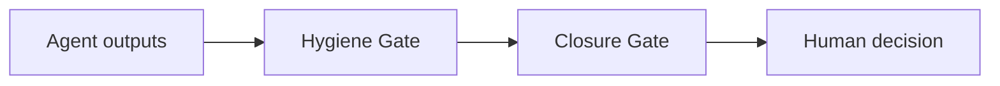

# Bridge-iT Bouncer

**Human-in-command, without the human-as-bottleneck.**

Bridge-iT Bouncer is a skills-only plugin for ChatGPT and Codex. It reduces raw AI output to the smallest verified unit of human attention.

## The execution problem

AI agents can create a new bottleneck: people must review duplicated, contradictory, incomplete, privacy-sensitive, or unauthorized work before anything can move forward. Bouncer inserts a verification layer before that review.



## Included skills

### Hygiene Gate

Inspects, reconciles, minimizes, and routes work before it reaches a person:

- removes duplicates and unnecessary personal information;
- separates verified facts from claims and recommendations;
- quantifies material changes;
- returns missing or contradictory work to the originating agent;
- blocks unresolved privacy and permission risks;
- forwards only verified material changes and genuine decisions.

### Closure Gate

Protects the final human-attention boundary:

- passes routine, authorized, reversible work silently;
- consolidates equivalent work;
- returns agent-resolvable issues for correction;
- presents the fewest possible verified human decisions;
- requires evidence before work is marked closed.

## Example prompts

- “Check these agent outputs and route anything that does not need my attention.”
- “Show me only the verified decision that genuinely requires my judgment.”
- “Verify whether this work is ready for closure.”

## Boundaries

Version 0.3.0 is skills-only. It has no MCP server, does not independently access external systems, does not collect data for Bridge-iT, and does not execute external actions. It operates on material supplied in the conversation and on tools separately authorized by the user and host environment.

The plugin supports decision hygiene; it does not replace professional legal, medical, financial, security, or employment judgment.

## Install from this marketplace

Supported Codex clients can add this repository as a marketplace source:

```bash
codex plugin marketplace add danyadotan/bridge-it-bouncer
```

Then install **Bridge-iT Bouncer** from the plugin browser and start a new session.

## Repository layout

- `plugins/bridge-it-bouncer/` — portable plugin package
- `.agents/plugins/marketplace.json` — repository marketplace catalog
- `tests/acceptance-cases.md` — reproducible behavior checks
- `PRIVACY.md`, `TERMS.md`, `SUPPORT.md` — public-use information

## Publisher

Created by **Danya Dotan — Bridge-iT**.

Bridge-iT is building execution infrastructure for AI-native organizations: change the environment, not the person.
